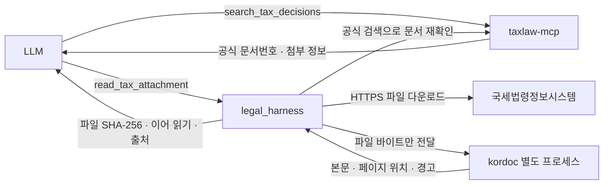

# 공식 첨부 원문 읽기

taxlaw-mcp는 지수님 저장소의 조회·원문 파일 제공 역할을 유지하고, legal_harness가 별도 kordoc 프로세스로 파일을 읽는다. 현재 taxlaw 운영 핀 `16a08b9`는 지수님 `a91872f`의 조회 로직과 같으며 포크의 버전 표시·운영 문서·동기화 설정을 추가한 것이다. 이번 작업은 taxlaw의 조회 코드를 바꾸거나 PDF PR #26을 병합하지 않는다.



## 파서 선택 근거

2026-10-14 같은 파일로 Kreuzberg MIT LTS 4.10.4와 kordoc 4.21.31을 비교했다. kordoc를 선택했다. 파일 전체를 외부 파싱 API로 보내지 않으며 기존 Node 서버에서 동작한다.

| 표본 | Kreuzberg 4.10.4 | kordoc 4.21.31 |
|---|---|---|
| 감사원 `2024심사636` PDF, 217,415바이트 | 본문 추출 가능 | 16쪽, 16,079 UTF-16 문자, 실제 MCP 이어 읽기 2회 통과 |
| 국세청 `2013심사397` 배포용 HWP, 48,640바이트 | 빈 본문 | 8,002 UTF-16 문자, 실제 MCP 1회 통과 |
| 표준 HWP 문단 레코드가 있는 테스트 문서 | 빈 본문 | 한국어 본문 추출 통과 |
| 자체 생성 HWPX 표본 | 최종 후보로 검증하지 않음 | 한국어 본문 추출 통과 |

LTS HWP 파서의 문단 태그 `0x50/0x51`은 표준 문서의 `0x42/0x43`과 달랐다. 동봉된 비표준 `converted_output.hwp`만 통과하는 것은 실제 HWP 지원 근거로 부족하다. 공식 후속 Xberg 1.3.9에는 일반 HWP 태그 수정이 있으나, 이번 kordoc 실측 결과와 기존 Node 운영 구조를 근거로 추가 Python 런타임이 필요 없는 kordoc를 채택했다. Xberg 전체 품질이 더 낮다고 결론 내린 것은 아니다.

고정 버전·커밋·npm 무결성 값은 [document-parser.json](../upstreams/document-parser.json)에 기록한다. 의존성은 `npm-shrinkwrap.json`으로 잠그고, MIT 고지는 [kordoc.LICENSE](../upstreams/kordoc.LICENSE)에 보존한다. PDF 엔진 `pdfjs-dist`도 정확한 버전으로 직접 의존하여 optional 패키지를 생략한 운영 설치에서도 PDF를 읽는다.

## 지원 범위와 한계

- 현재 도구 범위는 **국세법령정보시스템 감사원 심사청구 첨부**다. 임의 URL, 로컬 파일, 사용자 업로드를 받는 범용 파서 서버는 아니다.
- PDF 텍스트·HWP·HWPX를 읽는다. HWP 3은 공급자 형식 식별을 허용하지만 별도 실문서 검증은 아직 없다.
- PDF는 물리적 쪽 번호와 `#page=N` 출처를 반환한다. HWP/HWPX의 캐시된 쪽 수를 실제 쪽 번호로 단정하지 않고 `page_number: null`과 경고를 반환한다.
- OCR·수식 OCR·이미지 추출·모델 다운로드는 끈다. 비밀번호·DRM 해제는 제공하지 않는다. 텍스트가 전혀 없는 스캔본은 실패하고, 빈 PDF 페이지나 파서 경고는 부분 확인으로 표시한다.
- 표 병합, 이미지, 다단 배치, 각주 누락 가능성은 남는다. 특히 여러 쪽 표가 시작 쪽에 묶일 수 있으므로 인용 위치·조건·단서 조항은 원문과 대조한다. 추출 성공은 법률적 정확성이나 원문 전체성 검증이 아니다.

## 설치와 운영

기존 Node 22 이상 운영 환경에서 `npm ci --ignore-scripts --omit=dev --omit=optional`로 함께 설치한다. 추가 API 키·Python 파서 venv·OCR 모델은 필요하지 않다. 기존 taxlaw MCP의 Python 런타임은 계속 사용한다. 원격 MCP 이용자의 설치 방법은 바뀌지 않는다.

taxlaw provider가 구성되어 있으면 `read_tax_attachment`가 기본 공개된다. `DOCUMENT_PARSER_DISABLED=1`로 첨부 도구만 끌 수 있다. `/health.document_parser`와 MCP `tools/list`로 구성 여부를 확인한다. health의 버전 표시는 실시간 파일 파싱 성공 검사가 아니다.

기존 일일 law/taxlaw 업데이트 정책은 유지하며 파서 버전은 별도 테스트 후 명시적으로 갱신한다. npm 잠금 파일, 공급자 핀, worker의 버전 확인을 함께 바꿔야 한다.

2026-10-14 GCE 사전 확인에서 루트 볼륨 여유가 약 113 MiB(사용률 99%)였다. 설치 후보·롤백본 공간을 확보하기 전에는 운영 배포하지 않는다. 확인용 임시 파일은 제거했으며 이번 검증 중 운영 서비스 설정은 바꾸지 않았다.

## 호출과 연구 근거

```json
{"document_number":"2024심사636"}
```

`read_tax_attachment`는 공식 검색을 다시 호출해 문서번호가 정확히 일치하는 단일 행과 첨부 ID를 확인한다. 검색 결과가 잘렸거나 모호하면 파일을 추측해서 읽지 않는다. 내려받은 파일의 실제 바이트 수와 SHA-256을 기록한다.

`document.extraction.next_arguments`가 있으면 해당 인수로 계속 읽는다. SHA-256이 바뀌면 이어 읽기를 거절한다. 위치는 UTF-16 단위다. 응답 내 위치는 `units[].start/end`, 전체 추출 텍스트 위치는 `document_start/document_end`다. 등록일을 결정일로 바꾸지 않는다.

연구 도구는 `source_kind: extracted_attachment`와 파일 해시·파서 버전/커밋·쪽 출처를 보존한다. 범위를 벗어나거나 출처와 맞지 않는 위치는 근거로 등록하지 않는다. 일부 반환·파서 경고·HWP의 쪽 미확인은 `partial`, 완전성은 항상 `unverified`다. 전체 이어 읽기를 마쳤다고 하네스의 법리 검증 상태가 자동 통과하지 않는다.

한 번에 1건, 파일 8 MiB, 다운로드 12초, 파싱 20초, 전체 작업 중단 신호 55초, 200쪽·500,000 UTF-16 단위, JSON 출력 2 MiB로 제한한다. 각 호출은 다시 검색·다운로드하며 결과를 서버 디스크에 저장하지 않는다.

파서는 짧게 실행되는 자식 프로세스이고 앱 자격증명·환경 설정을 전달받지 않는다. Node 파일 권한은 실행 코드·설치 의존성 읽기만 허용하며 파일 쓰기·자식 프로세스·네이티브 애드온을 허용하지 않는다. 네트워크 호출도 worker에서 차단한다. V8 old-space 160 MiB, semi-space 8 MiB와 Linux RSS 256 MiB 감시를 적용한다. RSS 감시는 순간 할당을 완전히 방지하는 OS 메모리 격리가 아니며 Node 권한 모델도 악성 코드용 완전한 보안 샌드박스는 아니다. 종료·시간 초과 시 worker가 끝난 뒤 슬롯을 반환한다.

## 재현

```sh
npm ci --ignore-scripts --omit=optional
npm run audit:runtime
npm run review
npm run review:package
python3 scripts/install-taxlaw-mcp.py
node scripts/document-parser-smoke.mjs 2024심사636
node scripts/document-parser-smoke.mjs 2013심사397
```

오프라인 회귀 테스트는 실제 PDF·HWP·HWPX 파서, 크기·쪽 수·시간 제한, 이어 읽기, 파일 변경, 출처 위치, 공개 MCP 응답을 검증한다. 패키지 테스트는 tarball을 빈 prefix에 설치한 뒤 세 형식을 다시 읽는다. 로컬과 Ubuntu CI 모두 파서 테스트를 생략하지 않는다. 라이브 smoke는 실제 taxlaw MCP와 국세청 사이트에 의존하며 오프라인 테스트와 구분한다.

라이브 검증 원본 SHA-256:

- PDF: `ee620af5af10013fb413673ea2b57e7a3e87d7bf4b90cb397fbb45a822887619`
- HWP: `cdb09eab2d6164223acce8fd3135e5275fdc51ccc96cba1e1e5ecd4c588d9baa`

## 공급자 근거

- [고정 kordoc 소스](https://github.com/chrisryugj/kordoc/tree/f4e95b069d4f916365e5a13b5e6fc7b23f3f5c7c)
- [Kreuzberg LTS HWP 파서](https://github.com/kreuzberg-dev/kreuzberg-lts/blob/b8c96b3e25ade63d78c32fa0fa34a2afce6cd10e/crates/kreuzberg/src/extraction/hwp/parser.rs)
- [후속 Xberg HWP 파서](https://github.com/xberg-io/xberg/blob/fdb16150ed0bf8578d68e20ec32301bc2caa8fd1/crates/xberg/src/extraction/hwp/parser.rs)
- [taxlaw 원작자의 역할 분리 의견](https://github.com/zisu17/korean-taxlaw-mcp/pull/26#issuecomment-6147244829)
- [Node 권한 모델의 범위와 제한](https://nodejs.org/api/permissions.html)
